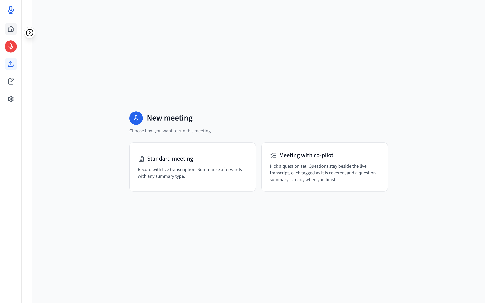
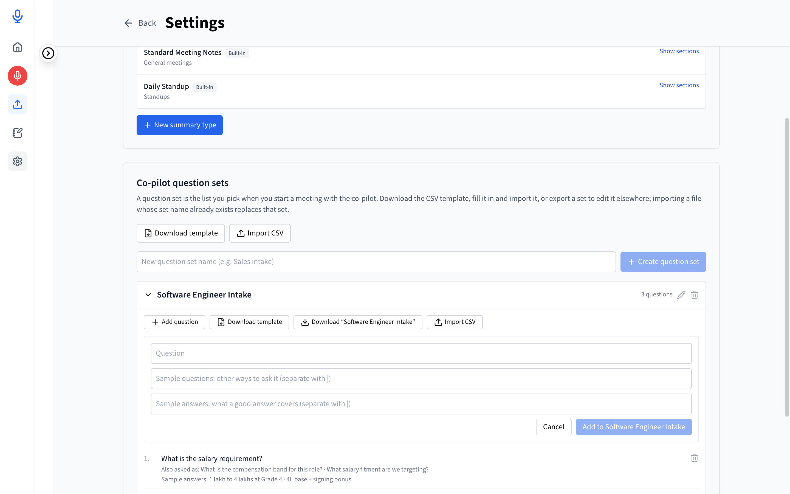
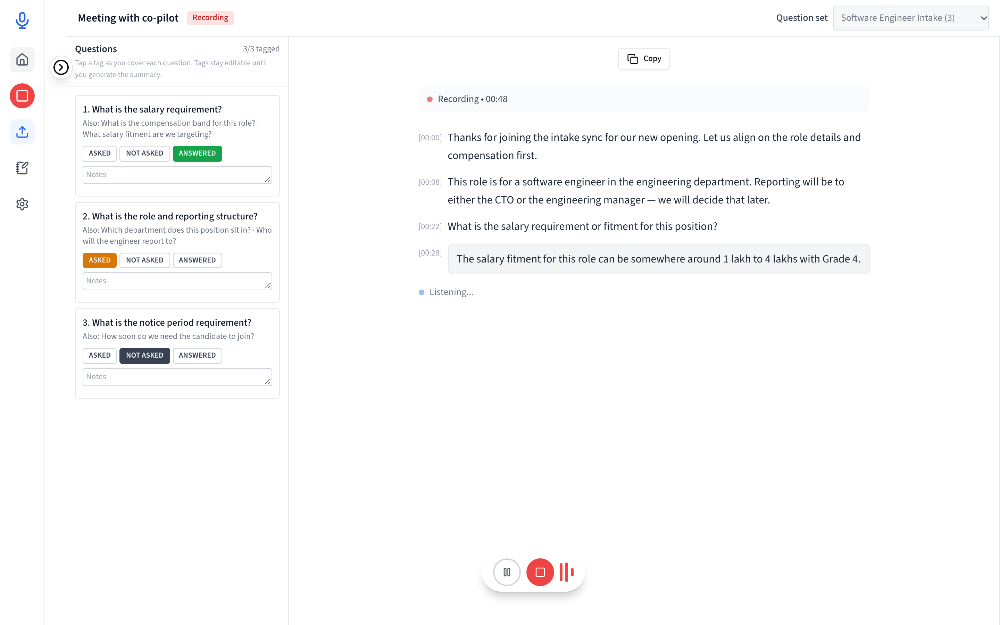
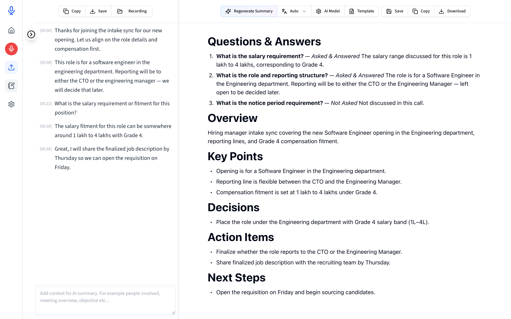

# Intake Pro

A local, private desktop meeting recorder with real-time transcription and an AI intake-call co-pilot for **macOS** (Apple Silicon) and **Windows** (x64). Audio, transcripts, question sets, and summaries stay 100% on your machine (see [`PRIVACY_POLICY.md`](PRIVACY_POLICY.md)). Version **1.0.0**.

Intake Pro is a fork of [Meetily](https://github.com/Zackriya-Solutions/meetily) (MIT); attribution is in [`LICENSE.md`](LICENSE.md).

---

## Screenshots

### 1. Launch Screen — Standard Meeting vs. Meeting with Co-Pilot


### 2. Question Sets — Add Questions, Sample Phrasings & Sample Answers


### 3. Live Co-Pilot Call — Question Tagging & Real-Time Transcription


### 4. Unified Post-Call Summary — Questions & Answers + Meeting Notes in One Document


---

## How It Works

### Two Meeting Types, One Unified Pipeline
On launch, choose **Standard meeting** or **Meeting with co-pilot**. Both use the exact same recording, transcription, and summarization engine — the only difference is that a Co-pilot meeting feeds your **question set** and **live call tags** as extra context into the post-call summarizer.

- **Standard meeting** → Full transcript in, structured meeting summary out (`Overview`, `Key Points`, `Decisions`, `Action Items`, `Next Steps`).
- **Meeting with co-pilot** → Full transcript + question set + live tags in, **one unified summary** out: every question with its evaluated status and reasoned answer first (`Questions & Answers`), followed immediately by the overall meeting summary in the same single section and downloadable document.

---

### Adding Questions, Sample Questions & Sample Answers
Under **Settings → Summarization → Co-pilot question sets**, you can build reusable question sets for intake calls, candidate screens, discovery calls, or requirement gathering:

1. **Main Question** — The primary question you intend to ask (e.g., *"What is the salary requirement?"*).
2. **Sample Questions** — Alternative ways the question might be phrased during a natural conversation (e.g., *"What is the compensation band for this role?" | "What salary fitment are we targeting?"*).
3. **Sample Answers** — Examples or rubric criteria describing what a complete answer looks like (e.g., *"1 lakh to 4 lakhs at Grade 4" | "4L base + signing bonus"*).

You can add questions directly in the UI or manage them in bulk via **CSV / Excel (`.xlsx`)**:
- **Download template** provides a ready-to-fill CSV with example rows.
- **Download** exports any existing question set to CSV.
- **Import CSV / XLSX** creates a new question set or updates an existing set with the same name (with a validation preview before importing).

```csv
question_set,question,sample_questions,sample_answers
Software Engineer Intake,What is the salary requirement?,What is the compensation band? | What salary fitment are we targeting?,1 lakh to 4 lakhs at Grade 4 | 4L base + signing bonus
```

Multiple values within `sample_questions` or `sample_answers` are separated by `|` (never `,`). Cells starting with `= + - @` are automatically escaped on export to prevent spreadsheet formula injection.

---

### Live Call Tagging & Post-Call Transcript Analysis

1. **During the Call — Manual Tagging Only (Zero AI Contention)**
   - Select a question set before starting recording.
   - The left panel displays all questions in the set with three manual buttons per question: **`ASKED`**, **`NOT ASKED`**, and **`ANSWERED`**, plus an optional notes field.
   - No LLM runs while recording — 100% of compute is dedicated to live audio capture and transcription.
2. **After the Call — Model-Driven Transcript Analysis & Unified Summary**
   - When the call ends, the background summarizer analyzes the **full transcript** alongside your **questions**, **sample questions/answers**, and **live tags**:
     - **`asked_and_answered`** — The topic was raised in the call and the transcript contains the answer. The model synthesizes the transcript into clean, third-person meeting-notes prose (never raw copy-paste) capturing all relevant details, hedges, and open items.
     - **`asked_not_answered`** — The question or topic was raised, but no usable answer was given in the transcript.
     - **`not_asked`** — The topic does not appear in the transcript (`"Not discussed in this call."`).
   - **Smart Tag Steering & Contradiction Detection**:
     - Questions tagged **`NOT ASKED`** skip transcript search to save time — *unless* transcript keywords indicate the topic was actually discussed, in which case the model trusts the transcript, writes up the answer, and notes the discrepancy (`"Tagged Not asked, but the transcript shows this question was discussed."`).
     - Questions tagged **`ASKED`** or **`ANSWERED`** guide the model to extract and synthesize the discussion from the transcript.
   - **Strict Validation & Retry**:
     - Model output is validated against a strict JSON schema (`status: "asked_and_answered" | "asked_not_answered" | "not_asked"` + `meeting_summary`). Invalid output is automatically retried up to 2× with no silent degradation to rule-based extraction.
3. **One-Click Download & Transcript Save**
   - **Download** saves the entire unified summary (`Questions & Answers` + `Meeting Summary`) as a single `.md` file locally.
   - **Save** exports the full timestamped transcript as a local `.txt` file using the native OS save dialog (`<Meeting-Title>-<YYYY-MM-DD>.txt`).

---

## Local Models

Intake Pro uses two local model types (configured in **Settings**):
- **Transcription model**: Local **Whisper** or **Parakeet** (ONNX).
- **Summarization / Reasoning model**: Local **Built-in AI** (`llama-server` GGUF sidecar, e.g. `Qwen 3.5`), **Ollama**, or an OpenAI-compatible endpoint.

Models are downloaded on demand and stored in your OS application data directory (`~/Library/Application Support/com.intakepro.app/models` on macOS, `%APPDATA%\com.intakepro.app\models` on Windows) — never inside the Git repository.

---

## Building from Source

See [`BUILDING.md`](BUILDING.md) for full macOS and Windows prerequisites.

```bash
# 1. Install frontend dependencies
cd frontend
pnpm install

# 2. Run in development mode
pnpm tauri:dev

# 3. Build production desktop installer (.app / .dmg on macOS, .exe / .msi on Windows)
pnpm tauri:build
```

---

## Verification & Quality Gates

Run from the repository root:

```bash
# Pure-Rust co-pilot analysis & rubric tests + retrieval evaluation harness
cargo test -p copilot-core
cargo run -p copilot-core --bin copilot-eval -- crates/copilot-core/tests/fixtures/intake_corpus.json

# Source-level security & architecture invariant audit (13 checks)
node scripts/intake-audit.mjs

# Frontend typecheck, lint, and unit tests
cd frontend && pnpm typecheck && pnpm lint && pnpm test

# End-to-end UI verification against mocked Tauri backend
node scripts/e2e-ui.mjs
```
